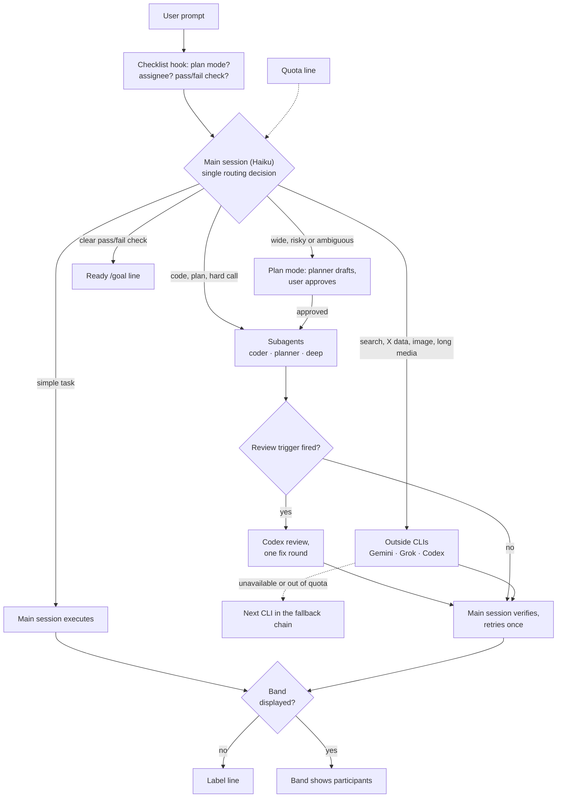

# Spick

<p align="center"></p>

**Stop picking, just start.**

Spick is a triage layer for Claude Code. It selects the model and effort for each task and delegates some tasks to existing subscription CLIs.

[中文说明](README.zh-CN.md)

## Overview

- The main session (Haiku) reads each prompt and makes a single routing decision, by the shape of the deliverable: a verdict goes to `deep`, a plan to `planner`, changed code to `coder`; the main session is the last line, for plain lookups.
- A keyword pass over each prompt adds a `Hint` line to the checklist naming the default route; the main session keeps a hinted task only with a stated reason.
- Subagents (`coder`, `planner`, `deep`) run on fixed models. Outside CLIs (Gemini, Grok, Codex) handle their specialised tasks.
- Each reply names its participants in a label line or in the band.

## Request flow



- Fallback chains: `skills/spick/references/providers.md`. Review triggers: `skills/spick/SKILL.md`.
- Label line format: `[Model: Haiku 5.5 (medium) → coder Sonnet 5.5 (high) | Review: skipped]`

## Roles and models

| Task | Assigned to |
|---|---|
| Lookups: Q&A, file lookup, summaries | Main session (Haiku) |
| Code changes | `coder` subagent (Sonnet) |
| Planning and design | `planner` subagent (Opus) |
| Judgements: comparisons, evaluations, diagnoses, complex reasoning, decisions, formal writing | `deep` subagent (Opus) |
| Web search, fact checking, long media | Gemini (`agy`) |
| X / Twitter data | Grok (`grok`) |
| Independent code review, image generation | Codex (`codex`) |

Default effort: `coder` medium, `planner` high, `deep` high.

## Dashboard


The band is an optional status line above the prompt that shows which participant is working.


`/spick` opens the pane, which contains hotkey switches and recent turns. Haiku reads a short quota line with each prompt; the pane shows local meters for Claude and Codex.

The gate and the guard are the mod's only two interventions; everything else it shows is read only. The gate: when a prompt's Hint line named a verdict (or a design) and the main session answered it without delegating anything, the stop is sent back once, telling it to dispatch `deep` (or `planner`) or to state in one line starting with `Kept:` why the deliverable was a plain lookup. It never fires twice in a turn, never on a short reply without tool calls (a question back), and `/spick gate off` switches it off.

The guard does two things while routing is in force. It caps the main session's own source edits at 3 distinct files per turn: a fourth file is refused with a message that names the three and asks for `Agent(coder)` (edits to the same files, a subagent's edits, and notes, data or `.claude/` files do not count). And when any loop, a subagent included, edited source in a turn and no loop ran a check (a test runner, a build check, a linter or a type checker), the stop is sent back once, asking it to run the project's check, hand the user a `/goal` line, or state in one line starting with `Unchecked:` why there is none. The gate and the guard together send a turn back at most once. `/spick guard off` switches the guard off, and the choice is remembered.

## Installation

```bash
npx skills add Brulek/spick
```

Then enter `spick setup` in Claude Code. Setup detects the installed CLIs, installs the subagents and registers the checklist hook.

Manual installation:

```bash
bash ~/.claude/skills/spick/scripts/setup.sh --check
bash ~/.claude/skills/spick/scripts/setup.sh --install --lanes gemini,grok,codex --model haiku --effort medium
```

Before it writes anything, `--install` copies `CLAUDE.md`, `settings.json` and `spick.json` into `~/.claude/spick-backup/<timestamp>/`, together with a `manifest.json` that records what the run changed.

In the desktop app, select Haiku once in the model menu.

### Dashboard mod (optional)

Run in a terminal:

    /plugin install spick-dashboard --marketplace Brulek/spick

While the band is displayed, replies omit the label line.

## Commands

| Command | Effect |
|---|---|
| `spick setup` | First-run setup |
| `spick doctor` | Lists installed and logged-in CLIs |
| `spick quota` | Displays the quota line |
| `/spick on\|force\|off` | Routing switch: `on` routes in a Haiku session only, `force` on any model |
| `/spick review on\|off` | Codex review step |
| `/spick gate on\|off` | The gate: a hinted verdict the main session kept is sent back once at stop time |
| `/spick guard on\|off` | The guard: at most 3 source files edited by the main session per turn, and a turn that edited source without running a check is sent back once at stop time |
| `/spick lane <id>` | Shows one lane's record |
| `/spick lane <id> on\|off` | Switches a lane on or off (field `enabled`, saved in `spick.json`) |
| `/spick lane <id> <field> <value>` | Changes any field of a lane through `set_lane.py` (tags take a comma list) |
| `/spick hide` / `show` | Hides or shows the band for the current session |
| `/spick quota` | Refreshes the quota line |

Pane hotkeys: `r` routing, `v` review, `e` gate, `d` guard, `g` `k` `c` Gemini / Grok / Codex, `l` the lanes page (edit tags, data and the rest; no Input on mobile), `b` band, `q` refresh quota, `x` close.

## Requirements

Claude Code 2.1 or later, bash and python3. Optional: `codex`, `grok` and `agy`, each logged in.

## Project layout

Routing rules: `skills/spick/`. Band and pane: `mod/spick-dashboard/`.

CI (`.github/workflows/ci.yml`) runs the python unit tests and the mod tests.

## Related projects

[alexei-led/claude-router](https://github.com/alexei-led/claude-router) switches the main session's model on each turn and can run alongside Spick.

## Known limitations

Spick does not change the main session's model. A mod can rewrite the model and effort of each request (`turn.step` in the engine types of Claude Code 2.1.299); claude-router and claude-agent-tools do that. Spick leaves it to them and composes with claude-router, so the main session runs on the lower-cost model and triages by checklist. The checklist is advice: the main session can still keep a task it should have delegated, which is what the Hint line and the deliverable-shaped item 2 are there to prevent.

## License

MIT.
