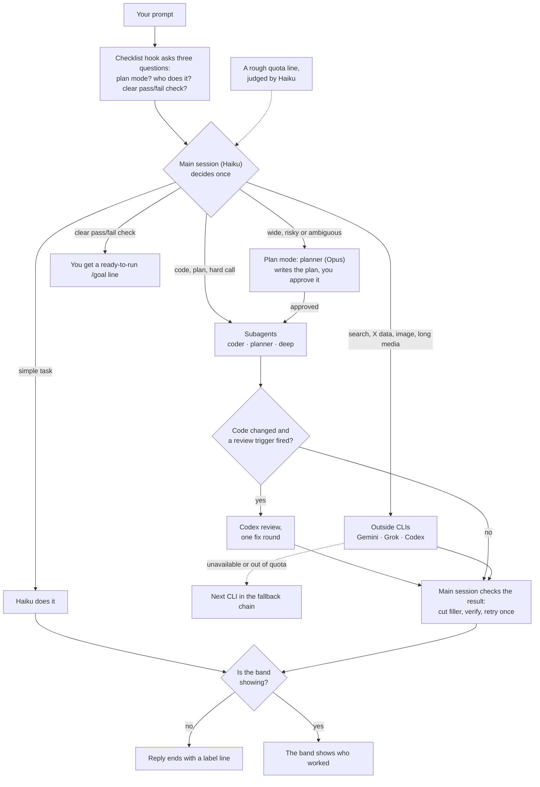

# Spick

<p align="center"></p>

**Stop picking, just start.** Spick is a triage layer for Claude Code. It chooses the Claude model and effort, and sends work to the subscription CLIs you already pay for.

[中文说明](README.zh-CN.md)

## In 30 seconds

- Haiku is the main session. It decides once, per prompt, who does the work.
- Subagents (`coder`, `planner`, `deep`) run on a fixed model. Outside CLIs (Gemini, Grok, Codex) take the jobs they do best.
- Every reply shows who worked, in a label line or in the band. A CLI that is not installed is skipped.

## How a request flows



- The fallback chain for each outside CLI is in `skills/spick/references/providers.md`.
- Codex reviews code only when a trigger fires: money, auth or unattended code, a big diff, no tests, or a hedged report. The triggers are in `skills/spick/SKILL.md`.
- A label line looks like this: `[Model: Haiku 5.5 (medium) → coder Sonnet 5.5 (high) | Review: skipped]`

## Who does what

| Task | Done by |
|---|---|
| Simple tasks: Q&A, files, summaries, running a script | Haiku, the main session |
| Code changes | `coder` subagent, runs on Sonnet |
| Planning and design | `planner` subagent, runs on Opus |
| Hard reasoning, decisions, formal writing | `deep` subagent, runs on Opus |
| Live web search, fact checks, long video or audio, huge documents | Gemini (`agy`, Antigravity CLI) |
| X / Twitter data | Grok (`grok`, Grok Build) |
| Independent code review, image generation | Codex (`codex`, ChatGPT subscription) |

Default effort: `coder` medium, `planner` high, `deep` high. The main session raises or lowers it per task.

## The dashboard (optional)


The band is a status line above the prompt. It shows who is working now, or who worked last when idle. On the right it shows why you should look, such as a Codex review or an edited source file.


`/spick` opens the pane: the routing, review and lane switches with hotkeys; a `This session` table of turns per lane and what they would have cost at API list rates; local quota meters for Claude and Codex; then the recent turns with model and effort. The quota line Haiku reads is not in the pane: it is appended to each prompt's triage checklist (Step 4 of the skill).

## Install

```bash
npx skills add Brulek/spick
```

Then open a Claude Code session and say `spick setup`. Setup:

- detects which CLIs are installed and logged in;
- asks which outside CLIs to enable and which main model to use;
- installs the three subagents into `~/.claude/agents/`;
- writes a short cheat sheet into `~/.claude/CLAUDE.md`;
- registers the per-prompt checklist hook (`scripts/triage-hook.sh`, a `UserPromptSubmit` hook in `~/.claude/settings.json`);
- optionally sets the default model and effort in `~/.claude/settings.json`.

Manual equivalent:

```bash
bash ~/.claude/skills/spick/scripts/setup.sh --check
bash ~/.claude/skills/spick/scripts/setup.sh --install --lanes gemini,grok,codex --model haiku --effort medium
```

In the desktop app, pick Haiku once in the model menu next to the prompt box. The app keeps its own choice and overrides `settings.json`.

### Dashboard mod (optional)

In a terminal session:

    /plugin install spick-dashboard --marketplace Brulek/spick

Answer `y` to add the marketplace and choose the user scope. The band then appears above the prompt, and `/spick` opens the pane. While the band shows, in the terminal or the desktop app, replies have no label line. `/spick hide` hides the band and brings the label line back.

## Commands

| Say | Effect |
|---|---|
| `spick setup` | first-run onboarding; can be run again |
| `spick doctor` | detection table: installed, logged in, versions |
| `spick quota` | shows the quota line for the subscriptions listed in `~/.claude/spick.json`; `--refresh` collects now |
| `/spick on\|off\|auto` | routing switch; auto turns it on only in a Haiku session, and choosing a model with `/model` turns it off for that session |
| `/spick review on\|off` | the Codex review step |
| `/spick lane <gemini\|grok\|codex> on\|off` | one outside CLI |
| `/spick hide` / `show` | the band, this session only |
| `/spick quota` | refresh the quota line now |

Spick remembers the routing, review and outside CLI settings across sessions.

Pane hotkeys: `r` routing (next value), `v` review, `g` `k` `c` Gemini / Grok / Codex, `b` band, `q` refresh quota, `x` close.

## Requirements

- Claude Code 2.1 or later (subagent `model` and `effort` frontmatter).
- bash and python3 for the two scripts. On Windows, use Git Bash or WSL.
- Optional: `codex`, `grok` and `agy`, logged in to their subscriptions. Image generation also needs the `codex-image` Claude Code plugin.
- Optional: Node 22.6 or later, to regenerate the README art.

## Layout

```
skills/spick/
├── SKILL.md                 the routing rules
├── references/providers.md  commands, flags, model ids, quota sources, known problems
├── references/onboarding.md first-run flow
├── scripts/quota.sh         quota collector (quota.py) and cache
├── scripts/setup.sh         detection and install
└── assets/                  subagent definitions, CLAUDE.md snippet
mod/spick-dashboard/         the dashboard mod (band and pane)
docs/images/                 README art and its generator
```

## Pairs well with

- [alexei-led/claude-router](https://github.com/alexei-led/claude-router): a Claude Code Mod that switches the main session's model and effort each turn, using a local or hosted classifier. Spick cannot do that. It has no outside CLIs, review triggers, quota awareness or onboarding; Spick has. The two work together.
- [tzachbon/claude-model-router-hook](https://github.com/tzachbon/claude-model-router-hook): a hook that warns, or sets the model for the next session.

## Known limits

- A Claude Code session cannot change its own model or effort. Only subagents can be set per task. So the main session runs on the cheap model.
- Cloud agents (Codex Cloud, ChatGPT agent mode, Grok web tasks) are out of scope.

## License

MIT.
