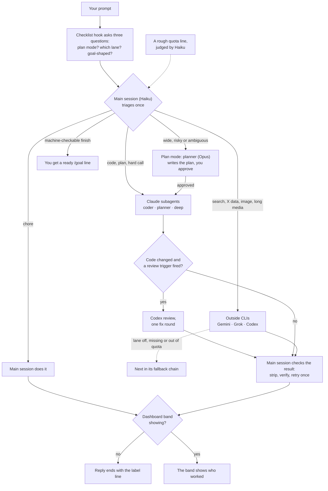

# Spick

<p align="center"></p>

**Stop picking, just start.** One triage layer for Claude Code: pick the Claude tier, the effort, and when to hand work to the subscription CLIs you already pay for.

[中文说明](README.zh-CN.md)

## In 30 seconds

- **Haiku is the main session and triages each prompt once.** It is small and cheap, so it decides who should do the work instead of doing everything itself.
- **Work goes to pinned-model subagents or to CLIs you already subscribe to.** Each delegate gets an effort level chosen per task.
- **You can always see who worked.** Replies end with a label line, or the dashboard band shows it. Claude is the default for work; a CLI that is not installed is skipped, so with nothing but Claude you still get the internal tiering.

## How a request flows



- The fallback chain for each lane is in `skills/spick/references/providers.md`.
- Codex review runs only when a short trigger checklist fires (money, auth or unattended code, big diffs, no tests, hedged reports); the triggers are in `skills/spick/SKILL.md`.
- A label line looks like this: `[Model: Haiku 5.5 (medium) → coder Sonnet 5.5 (high) | Review: skipped]`

## Who does what

| Task | Goes to |
|---|---|
| Chores (Q&A, files, summaries, run a script) | the main session itself |
| Code changes | `coder` subagent, pinned to Sonnet |
| Planning and design | `planner` subagent, pinned to Opus |
| Hard reasoning, decisions, formal writing | `deep` subagent, pinned to Opus |
| Live web search, fact checks, long video/audio, huge documents | Gemini (`agy`, Antigravity CLI) |
| X / Twitter data | Grok (`grok`, Grok Build) |
| Independent code review, image generation | Codex (`codex`, ChatGPT subscription) |

Default effort: `coder` Medium, `planner` High, `deep` High. The triage layer raises or lowers it per task.

## The dashboard (optional)


The band above the prompt shows who is working right now, and who worked last when idle; an attention cause (a Codex review, an edited source file) shows on the right.


`/spick` opens the pane: the routing, review and lane switches with hotkeys, then the recent turns. Below them the pane also has a quota section, a rough quota line judged by Haiku, and a session cost section with estimated cost per lane.

## Install

```bash
npx skills add Brulek/spick
```

Then open a Claude Code session and say `spick setup`. The onboarding detects which CLIs are installed and logged in, asks which lanes to enable and which main model to use, installs the three subagents into `~/.claude/agents/`, writes a short cheat sheet into `~/.claude/CLAUDE.md`, registers a per-prompt triage checklist hook (`scripts/triage-hook.sh`, a `UserPromptSubmit` hook in `~/.claude/settings.json`), and (optionally) sets the default model and effort in `~/.claude/settings.json`.

Manual equivalent:

```bash
bash ~/.claude/skills/spick/scripts/setup.sh --check
bash ~/.claude/skills/spick/scripts/setup.sh --install --lanes gemini,grok,codex --model haiku --effort medium
```

Desktop app users: pick Haiku once in the composer's model menu. The app remembers its own choice and overrides `settings.json`.

### Dashboard mod (optional)

In a terminal session:

    /plugin install spick-dashboard --marketplace Brulek/spick

Answer `y` to add the marketplace, pick the user scope. The band above the prompt then shows who is working; `/spick` opens the pane. While the band shows (terminal or desktop app), replies carry no label line; hide it with `/spick hide` and the label line returns.

## Commands

| Say | Effect |
|---|---|
| `spick setup` | first-run onboarding (re-runnable) |
| `spick doctor` | detection table: installed, logged in, versions |
| `spick quota` | the quota line for the subscriptions listed in `~/.claude/spick.json`; `--refresh` collects now |
| `/spick on\|off\|auto` | routing switch (auto = on only in a Haiku session; picking a model with `/model` turns it off for the session) |
| `/spick review on\|off` | the Codex review step |
| `/spick lane <gemini\|grok\|codex> on\|off` | one outside lane |
| `/spick hide` / `show` | the band, this session only |
| `/spick quota` | refresh the quota line now |

The routing, review and lane choices are remembered across sessions.

Pane hotkeys: `r` routing (next value), `v` review, `g` `k` `c` Gemini / Grok / Codex lanes, `b` band, `q` refresh quota, `x` close.

## Requirements

- Claude Code 2.1+ (subagent `model`/`effort` frontmatter).
- bash and python3 for the two scripts (Git Bash or WSL on Windows).
- Optional: `codex`, `grok`, `agy` CLIs logged into their subscriptions; the `codex-image` Claude Code plugin for image generation.
- Optional, to regenerate the README art: Node 22.6+.

## Layout

```
skills/spick/
├── SKILL.md                 the routing rules
├── references/providers.md  spells, flags, model ids, quota sources, pitfalls
├── references/onboarding.md first-run flow
├── scripts/quota.sh         quota collector (quota.py) and cache
├── scripts/setup.sh         detection and install
└── assets/                  subagent definitions, CLAUDE.md snippet
mod/spick-dashboard/         the dashboard mod (band above the prompt, /spick pane)
docs/images/                 README art and its generator
```

## Pairs well with

- [alexei-led/claude-router](https://github.com/alexei-led/claude-router): a Claude Code Mod that switches the main session's model and effort per turn using a local or hosted classifier. It covers the one thing this skill cannot (re-pricing the main conversation); this skill covers what it leaves out (outside CLIs, review triggers, quota awareness, onboarding). The two compose.
- [tzachbon/claude-model-router-hook](https://github.com/tzachbon/claude-model-router-hook): hook-based variant that warns or sets the next session's model.

## Known limits

- A Claude Code session cannot change its own model or effort; only delegates can be re-priced. That is why the main session is cheap and everything else is pinned.
- Cloud agents (Codex Cloud, ChatGPT agent mode, Grok web tasks) are out of scope.

## License

MIT licensed.
