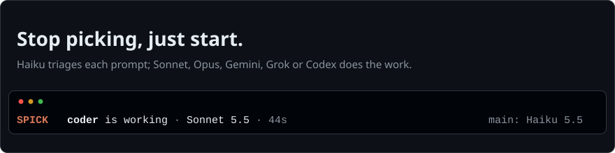
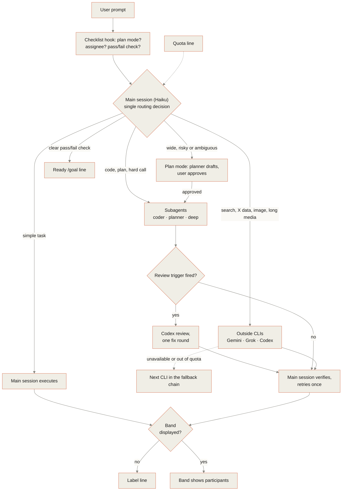
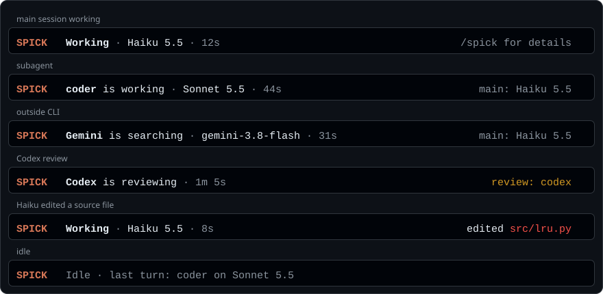
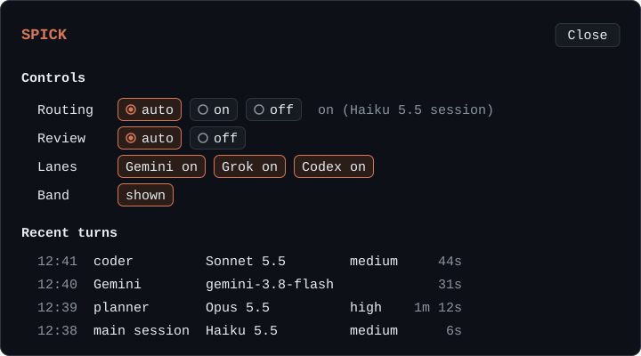

# Spick

<p align="center"></p>

<p align="center">Spick is a triage layer for Claude Code. It selects the model and effort for each task and delegates some tasks to existing subscription CLIs.</p>

Spick keeps the main session cheap and spends Opus only on tasks that need it, so the Gemini, Grok and Codex CLIs you already pay for do not sit idle. The external CLIs are optional: without them Spick still routes work between Claude's Sonnet and Opus subagents.

<p align="center">
<a href="LICENSE"></a>
<a href="#requirements"></a>
<a href="https://github.com/Brulek/spick/actions/workflows/ci.yml"></a>
</p>

<p align="center">
<a href="#quick-start">Quick start</a> · <a href="#dashboard-optional">Dashboard</a> · <a href="#commands">Commands</a> · <a href="#faq">FAQ</a> · <a href="README.zh-CN.md">中文</a>
</p>

## What it does

- The main session (Haiku) reads each prompt and makes a single routing decision. It routes by the shape of the deliverable: a verdict goes to `deep`, a decision about architecture, an interface or a data format to `planner`, code beyond one file to `coder`. Small work (a lookup, a one-file edit with a clear goal) stays in the main session, because every handoff has a cost.
- A keyword pass over each prompt adds a `Hint` line to the checklist. The line names the default route. Words inside paths, URLs and code blocks, and words right after a negation (不要, don't), do not count. The main session keeps a hinted task only with a stated reason.
- Subagents (`coder`, `planner`, `deep`, and `Explore` for searches) run on fixed models and end with a short Evidence block (checks run, files changed, limits) that the main session keeps. Outside CLIs (Gemini, Grok, Codex) handle their specialised tasks.
- Each reply names its participants, in a label line or in the band.

## Quick start

1. Install the skill:

   ```bash
   npx skills add Brulek/spick
   ```

2. Enter `spick setup` in Claude Code. Setup detects the installed CLIs, installs the subagents and registers the checklist hook.
3. In the desktop app, select Haiku once in the model menu; Spick routes only in a Haiku session unless forced (`/spick force`).

Manual installation, the dashboard mod and uninstall are under [Installation](#installation).

## How it works



- The policy is one file, `skills/spick/assets/rules.json`: the routing order, the effort defaults, the hint keywords and the checklist text. `scripts/render_rules.py` renders the hook's checklist, the mod's text and the tables in `SKILL.md` and the CLAUDE.md block from it.
- Fallback chains: `skills/spick/references/providers.md`. Review triggers: `skills/spick/SKILL.md`.
- Label line format: `[Model: Haiku 5.5 (medium) → coder Sonnet 5.5 (high) | Review: skipped]`

## Roles and models

| Task | Assigned to |
|---|---|
| Lookups (Q&A, file lookup, summaries) and one-file edits with a clear goal | Main session (Haiku) |
| Code changes beyond one file | `coder` subagent (Sonnet) |
| Decisions on architecture, a public interface, a data format or a cross-module trade-off | `planner` subagent (Opus), then `coder` |
| Judgements: comparisons, evaluations, diagnoses, complex reasoning, decisions, formal writing | `deep` subagent (Opus) |
| Searching a repository for files and symbols | `Explore` subagent (Haiku) |
| Web search, fact checking, long media | Gemini (`agy`) |
| X / Twitter data | Grok (`grok`) |
| Independent code review, image generation | Codex (`codex`) |

Default effort: `coder` medium, `planner` high, `deep` medium (raised per task: high for hard or multi-file problems, xhigh for key decisions). The table, the efforts and the checklist text all come from one file, `skills/spick/assets/rules.json`.

**Explore on Haiku.** Claude Code's built-in Explore subagent runs on the main session's model, so an Opus session greps on Opus. Setup installs `~/.claude/agents/Explore.md` (`model: haiku`, `effort: low`, tools Read, Grep, Glob, Bash); `--no-explore` skips it. The Claude Code subagent docs say a user or project subagent named `Explore` overrides the built-in and keeps its own model. That is the documented behaviour, checked against the docs on 2026-10-17, not observed at runtime: `claude agents` lists background sessions, not subagent definitions. "Read-only" is the tool list and the agent's instructions, a tool-level soft bound, not a permission: a Bash command can still write.

## Dashboard (optional)



The band is an optional status line above the prompt that shows which participant is working.



`/spick` opens the pane, which contains hotkey switches and recent turns. Haiku reads a short quota line with each prompt; the pane shows local meters for Claude and Codex with the age of each sample (when Claude Code or the Codex log sampled it, never when the pane read the file).

The band also shows the main loop's last prompt size (`ctx 42k`). On a Haiku session above 80,000 tokens it warns `context 85k: Haiku bills 5x above 100k; /clear or delegate`: Haiku 5.5 bills a prompt over 100K tokens at five times the rate.

The mod acts on facts, at the cheapest moment. Everything else it shows is read only.

**The guard**, while routing is in force:

- Edit cap: the main session may edit one source file itself per turn. A second file is refused with a message that names the first and asks for `Agent(coder)`. Further edits to the same file, a subagent's edits, and notes (`.md`, `.txt`), tables (`.csv`, `.tsv`), logs, lock files and a leading `.claude/` do not count; json, yaml and toml do, and so does a worktree under `.claude/worktrees/`. The cap is a tool-level soft bound: it sees Edit, Write and NotebookEdit, not Bash writes such as `sed -i` or a redirection.
- Check at stop: when any loop, a subagent included, edited source in a turn and no check passed after the last edit, the stop is sent back. A check counts only when the runner is the command itself (after `cd x &&`, `env`, `npx`, `sudo`, `time`; `echo pytest` and `grep pytest README` are not checks), it exited cleanly (`pytest || true` and `pytest --version` do not count), and no source edit came after it started. A project with its own check command declares it as a regex in `<config>/spick.json` under `guard.check_commands` (see `skills/spick/references/providers.md`). The main session is asked to run the project's check, hand the user a `/goal` line, or state why there is none in one line starting with `Unchecked:` (or `未验证:`).
- Escalation: when the same check fails twice in a turn, the second failure's result carries one line telling the main session to dispatch `coder` at effort high, or `deep` if the cause is unknown, instead of a third fix of its own.
- `/spick guard off` switches the guard off, and the choice is remembered.

**The gate** asks for the role a hinted verdict needs: judgement words need `deep`, review words the review lane (Codex with a review prompt, or a lane tagged `review`) or `deep`. Design words stay a Hint line and never gate.

- At stop, the turn is sent back when that role did not complete (a `deep` subagent that finished, or still runs in the background; a review call that returned cleanly; a refused, failed or timed-out call does not count), the reply has no line starting with `Kept:` (or `自留:`), and the turn was substantive (a tool call, or a reply of 400 characters or more).
- `/spick gate off` switches it off.

The gate and the guard send a turn back at most once, with every reason in one block.

**Effort defaults.** An Agent call of `coder`, `planner` or `deep` that names no effort runs at the default from `efforts` in `<config>/spick.json` (coder medium, planner high, deep medium when it is not set).

**The turn record.** Each main turn is one JSON line in `<config>/spick/turns/<sessionId>.jsonl` (`<config>` is `CLAUDE_CONFIG_DIR`, else `~/.claude`): the hint, what ran (each delegate with its status, model, effort, usage and cost), the gate's firings and what followed, the `Kept:` line, the edits, every check with its exit status, any escalation, the main loop's usage and its last prompt size. A background agent that finishes later adds a `late` line for the same turn. `/spick spend` sums the cost of the last seven days (`scripts/spend.py`, which also reads the per-session files of mod 0.x); `/spick audit` runs `scripts/audit.py`: turns by hint kind and what ran, how hinted verdicts ended, gate outcomes and false positive candidates, edits with no passing check, escalations, cost by lane and by kind, and the longest sessions by context size.

## Installation

The usual path is the [Quick start](#quick-start) above.

Manual installation:

```bash
bash ~/.claude/skills/spick/scripts/setup.sh --check
bash ~/.claude/skills/spick/scripts/setup.sh --install --lanes gemini,grok,codex --model haiku --effort medium
```

Before it writes anything, `--install` checks that `settings.json` and `spick.json` are valid JSON (if not, it stops with nothing changed), then copies `CLAUDE.md`, `settings.json` and `spick.json` into `~/.claude/spick/backup/<timestamp>/`, together with a `manifest.json` that records what the run changed. Every step is checked: a step that fails stops the run with exit 1, naming what was already changed, and `done` is printed only when every step passed. `--no-explore` skips the Haiku `Explore` subagent.

State lives in `~/.claude/spick/` (with `CLAUDE_CONFIG_DIR` set, in `$CLAUDE_CONFIG_DIR/spick/`): the quota cache `quota.json`, one turn record per session in `turns/<sessionId>.jsonl`, the mod's session markers in `mod-active/`, and the backups. An install moves the files of earlier versions (`spick-quota.json`, `spick-spend/`, `spick-gate.jsonl`, `spick-backup/`) there once. `spick.json` stays in `~/.claude/`; it records the installed version, and the checklist says `spick: skill X installed Y, run spick setup` when the skill on disk is newer.

In the desktop app, select Haiku once in the model menu.

### Dashboard mod (optional)

Run in a terminal:

    /plugin install spick-dashboard --marketplace Brulek/spick

While the band is displayed, replies omit the label line.

### Uninstall

```bash
bash ~/.claude/skills/spick/scripts/setup.sh --uninstall [--purge] [--force]
```

It backs up first, like `--install`. Then it removes only what the install wrote:

- the block between the spick markers in `CLAUDE.md`;
- the checklist hook in `settings.json`;
- the four subagents (`coder`, `planner`, `deep`, `Explore`);
- the quota cache and the mod's session markers.

What it leaves alone:

- `model` and `effortLevel` go back to their value from before the install only if they still hold the value the install set.
- A subagent file you edited is kept unless you pass `--force`.
- `spick.json` and `~/.claude/spick/` (turn records, backups) are kept unless you pass `--purge`, which removes both.

Two steps remain for you: `claude plugin uninstall spick-dashboard` and deleting `~/.claude/skills/spick`.

## Commands

| Command | Effect |
|---|---|
| `spick setup` | First-run setup |
| `spick doctor` | Lists installed and logged-in CLIs |
| `spick quota` | Displays the quota line |
| `/spick on\|force\|off` | Routing switch: `on` routes in a Haiku session only, `force` on any model |
| `/spick review on\|off` | Codex review step |
| `/spick gate on\|off` | The gate: a hinted verdict the main session kept is sent back once at stop time |
| `/spick guard on\|off` | The guard: the main session edits at most 1 source file per turn itself (a second is refused and handed to `coder`), and a turn that edited source without a passing check is sent back once at stop time. The cap is a tool-level soft bound: edits made through Bash (`sed -i`, a redirection) are not counted |
| `/spick lane <id>` | Shows one lane's record |
| `/spick lane <id> on\|off` | Switches a lane on or off (field `enabled`, saved in `spick.json`) |
| `/spick lane <id> <field> <value>` | Changes any field of a lane through `set_lane.py` (tags take a comma list) |
| `/spick hide` / `show` | Hides or shows the band for the current session |
| `/spick quota` | Refreshes the quota line |
| `/spick spend` | What the sessions cost in the last 7 days, by lane (`scripts/spend.py`; `--days N`, `--by lane\|day\|session`, `--json` when run by hand) |
| `/spick audit` | What the turn records show for the last 7 days: what ran for each hint kind, gate firings and their outcomes, edits without a passing check, cost by lane (`scripts/audit.py --days N`) |

Where `/spick spend` and `/spick audit` get their data: the mod writes one turn record per session to `~/.claude/spick/turns/<sessionId>.jsonl`, a line per main turn with who ran, the usage, the gate and the checks. Sessions from earlier versions are read from the old per-session spend files. Without the mod there is no record: the bash hook sees no usage.

Pane hotkeys: `r` routing, `v` review, `e` gate, `d` guard, `g` `k` `c` Gemini / Grok / Codex, `l` the lanes page (edit tags, data and the rest; no Input on mobile), `b` band, `q` refresh quota, `x` close.

## Requirements

- Claude Code 2.1 or later, bash and python3.
- Optional: `codex`, `grok` and `agy`, each logged in.
- A lane key stored as `keychain:<name>` works on macOS only; on Linux and Windows use `env:<VAR>`.
- `CLAUDE_CONFIG_DIR` is honoured by setup, the hook, the scripts (`scripts/paths.py` is the one resolver) and the dashboard mod: state lives in `<config>/spick/`.

## FAQ

### Does Spick switch the main session's model?

No. Spick does not change the main session's model. To switch it on each turn, run claude-router alongside Spick. See [Known limitations](#known-limitations).

### Sessions on Sonnet, Opus or Fable

With `/spick on` (the default) such a session routes nothing, by design: the main model can do the work itself, so the checklist is replaced by one sentence saying so. Without the dashboard mod the CLAUDE.md block says the same. `/spick force` keeps the delegation on any model: `coder` still runs edits in its own context, and `deep` still gives an independent second opinion, even though the main model could do both. That is worth it in long sessions where the main context would fill with edit noise, and for verdicts you want checked by a fresh context.

### Do I need Gemini, Grok and Codex?

No. `codex`, `grok` and `agy` are optional; each one you want to use must be logged in. `spick doctor` lists which are installed and logged in.

### What does setup change, and can I undo it?

Before it writes anything, `--install` backs up `CLAUDE.md`, `settings.json` and `spick.json` into `~/.claude/spick/backup/<timestamp>/`. `--uninstall` removes only what the install wrote; see [Uninstall](#uninstall).

### Can I use Spick without the dashboard mod?

Yes. Without the band, replies name their participants in the label line. The spend record needs the mod: the bash hook sees no usage.

### Where do lane keys go?

A key stored as `keychain:<name>` works on macOS only. On Linux and Windows, use `env:<VAR>`.

## Known limitations

Spick does not change the main session's model. A mod can rewrite the model and effort of each request (`turn.step` in the engine types of Claude Code 2.1.299); claude-router and claude-agent-tools do that. Spick leaves it to them and composes with claude-router, so the main session runs on the lower-cost model and triages by checklist. The checklist is advice: the main session can still keep a task it should have delegated, which is what the Hint line and the deliverable-shaped item 2 are there to prevent.

- The Hint line is a keyword pass, not a classifier: it misses verdicts phrased without its words and fires on a few it should not (版本号 reads as a web sign). Its labelled corpus is `skills/spick/scripts/testdata/hint_corpus.json`.
- A lane's `data` level is a declared limit, not sensitive-data detection. `scripts/invoke.py` refuses a call above it (exit 6), takes a prompt without `--contains` as code, and scans for code-looking text under a `text` or `public` declaration; it does not look for secrets or personal data.
- The guard's edit cap and the `Explore` agent's read-only tool list are tool-level soft bounds: a Bash command can still write files.
- That a user-level `Explore` replaces the built-in one is what the Claude Code docs say; it has not been observed at runtime here.

## Related projects

[alexei-led/claude-router](https://github.com/alexei-led/claude-router) switches the main session's model on each turn and can run alongside Spick.

## Contributing

Issues and pull requests are welcome.

Layout: routing rules live in `skills/spick/`; the band and pane live in `mod/spick-dashboard/`. The routing policy is `skills/spick/assets/rules.json`: edit it, then run `python3 skills/spick/scripts/render_rules.py` (CI's unit tests run `--check`, which fails when a rendered copy drifts). The changes per version are in [CHANGELOG.md](CHANGELOG.md).

CI (`.github/workflows/ci.yml`) runs the python unit tests and the mod tests. To run them locally, from the repo root:

- Python unit tests: `cd skills/spick/scripts && python3 -m unittest -q`
- Mod tests: `claude plugin test mod/spick-dashboard`

The images in this README are generated from the mod's own band and table code. To regenerate them, run `node --experimental-strip-types docs/images/make-art.mts` from the repo root.

## Buy me a coffee

Spick is free and MIT licensed. If it saves you time and you want to support the author, you can send a tip on BNB Smart Chain.

<p><br>
<sub>BNB Smart Chain · for supporting the author</sub></p>

Address (BNB Smart Chain):

    0x25Ca60556e44a9Fe213cC45177F04413094975F9

Send on BNB Smart Chain only. A transfer on another network may be lost.

## License

MIT, see [LICENSE](LICENSE).

## Evaluation

`skills/spick/evals/ab/` is an A/B harness: eight small tasks run through `claude -p` under a spick arm and several baselines (single-model and free-to-delegate), graded by exact checks, hidden tests and a blind judge, with a report of quality, completion, cost per successful delivery and latency. It is a signal for these tasks, not a proof of general non-inferiority. See [skills/spick/evals/ab/README.md](skills/spick/evals/ab/README.md) for the arms, flags, limits and the command for the full matrix.
