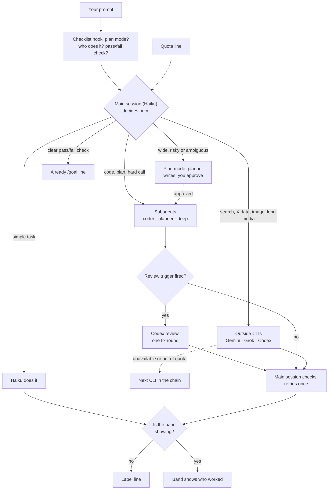

# Spick

<p align="center"></p>

**Stop picking, just start.** Spick is a triage layer for Claude Code. It picks the model and effort for each task and sends some tasks to subscription CLIs you already pay for.

[中文说明](README.zh-CN.md)

## In 30 seconds

- The main session (Haiku) reads each prompt and decides once who does the work.
- Subagents (`coder`, `planner`, `deep`) run on fixed models. Outside CLIs (Gemini, Grok, Codex) take what they do best.
- Each reply shows who worked, in a label line or the band.

## How a request flows



- Fallback chains: `skills/spick/references/providers.md`. Review triggers: `skills/spick/SKILL.md`.
- Label line: `[Model: Haiku 5.5 (medium) → coder Sonnet 5.5 (high) | Review: skipped]`

## Who does what

| Task | Done by |
|---|---|
| Simple tasks: Q&A, files, summaries | Main session (Haiku) |
| Code changes | `coder` subagent (Sonnet) |
| Planning and design | `planner` subagent (Opus) |
| Hard reasoning, decisions, formal writing | `deep` subagent (Opus) |
| Web search, fact checks, long media | Gemini (`agy`) |
| X / Twitter data | Grok (`grok`) |
| Independent code review, image generation | Codex (`codex`) |

Default effort: `coder` medium, `planner` high, `deep` high.

## The dashboard (optional)


The band is a status line above the prompt. It shows who works.


`/spick` opens the pane: switches with hotkeys, and recent turns. Haiku reads a short quota line with each prompt; the pane shows local meters for Claude and Codex.

## Install

```bash
npx skills add Brulek/spick
```

Then in Claude Code say `spick setup`. It detects your CLIs, installs the subagents and registers the checklist hook.

Manual:

```bash
bash ~/.claude/skills/spick/scripts/setup.sh --check
bash ~/.claude/skills/spick/scripts/setup.sh --install --lanes gemini,grok,codex --model haiku --effort medium
```

In the desktop app, pick Haiku once in the model menu.

### Dashboard mod (optional)

In a terminal:

    /plugin install spick-dashboard --marketplace Brulek/spick

While the band shows, replies have no label line.

## Commands

| Say | Effect |
|---|---|
| `spick setup` | first-run setup |
| `spick doctor` | which CLIs are installed and logged in |
| `spick quota` | shows the quota line |
| `/spick on\|off\|auto` | routing switch |
| `/spick review on\|off` | the Codex review step |
| `/spick lane <gemini\|grok\|codex> on\|off` | one outside CLI |
| `/spick hide` / `show` | the band, this session only |
| `/spick quota` | refresh the quota line |

Pane hotkeys: `r` routing, `v` review, `g` `k` `c` Gemini / Grok / Codex, `b` band, `q` refresh quota, `x` close.

## Requirements

Claude Code 2.1 or later, bash and python3. Optional: `codex`, `grok` and `agy`, logged in.

## Layout

Rules: `skills/spick/`. Band and pane: `mod/spick-dashboard/`.

## Pairs well with

[alexei-led/claude-router](https://github.com/alexei-led/claude-router) switches the main session's model each turn.

## Known limits

A session cannot change its own model, so the main session runs on the cheap one.

## License

MIT.
