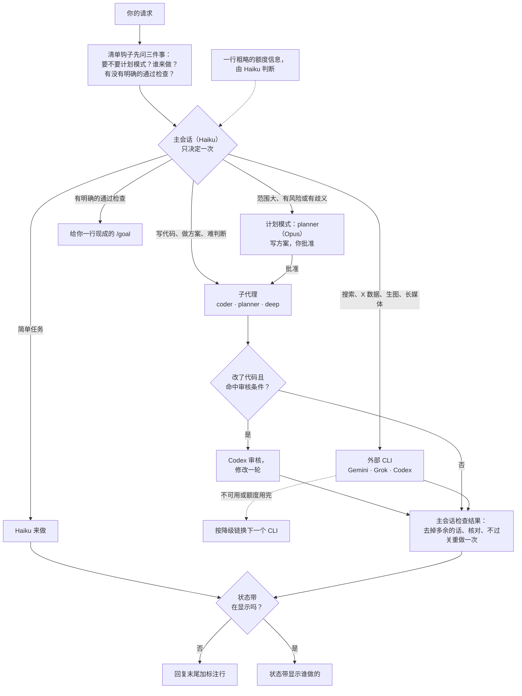

# Spick

<p align="center"></p>

**Stop picking, just start.** Spick 是 Claude Code 的分诊层。它决定用哪个 Claude 模型、什么推理强度，以及什么时候把任务交给你已订阅的 CLI。

[English](README.md)

## 30 秒看懂

- Haiku 是主会话。它读每条请求，只分诊一次，决定谁来做。
- 子代理（`coder`、`planner`、`deep`）用固定的模型，推理强度按任务设定。外部 CLI（Gemini、Grok、Codex）做各自擅长的事。
- 每次回复都能看出谁做的：末尾有一行标注，或看状态带。没装的外部 CLI 会被跳过，只装 Claude 也有分层。

## 一条请求怎么走



- 每个外部 CLI 的降级链见 `skills/spick/references/providers.md`。
- 只有触发条件命中时，才会让 Codex 审核代码：涉及钱、权限或定时任务，改动大，没有测试，报告里带不确定的话。条件见 `skills/spick/SKILL.md`。
- 标注行的样子：`[Model: Haiku 5.5 (medium) → coder Sonnet 5.5 (high) | Review: skipped]`

## 谁干什么

| 任务 | 谁来做 |
|---|---|
| 简单任务：问答、查文件、摘要、跑脚本 | 主会话 Haiku |
| 改代码 | `coder` 子代理，用 Sonnet |
| 规划设计 | `planner` 子代理，用 Opus |
| 难推理、关键决策、正式写作 | `deep` 子代理，用 Opus |
| 联网搜索、事实核查、长视频音频、超长文档 | Gemini（`agy`，Antigravity CLI） |
| X / Twitter 数据 | Grok（`grok`，Grok Build） |
| 独立代码审核、生图 | Codex（`codex`，ChatGPT 订阅） |

默认推理强度：`coder` medium，`planner` high，`deep` high。主会话会按任务调高或调低。

## 仪表盘（可选）


状态带是提示框上方的一行状态栏。它显示此刻谁在做事，空闲时显示上一轮是谁做的。右侧显示需要留意的原因，例如 Codex 审核或改了源码文件。


面板用 `/spick` 打开。里面有分流、审核和外部 CLI 的快捷键开关，最近几轮记录，一行由 Haiku 判断的额度信息，以及本会话每个外部 CLI 的估算成本。

## 安装

```bash
npx skills add Brulek/spick
```

然后开一个 Claude Code 会话，说 `spick setup`。它会：

- 探测装了哪些 CLI、登录没有；
- 问你启用哪几个外部 CLI、主会话用什么模型；
- 把三个子代理装进 `~/.claude/agents/`；
- 往 `~/.claude/CLAUDE.md` 写一段速查表；
- 注册分诊清单钩子，每条请求都会运行（`scripts/triage-hook.sh`，即 `~/.claude/settings.json` 里的 `UserPromptSubmit` 钩子）；
- 可选：把默认模型和推理强度写进 `~/.claude/settings.json`。

手动等价命令：

```bash
bash ~/.claude/skills/spick/scripts/setup.sh --check
bash ~/.claude/skills/spick/scripts/setup.sh --install --lanes gemini,grok,codex --model haiku --effort medium
```

桌面 app 里，在输入框旁的模型菜单选一次 Haiku。app 有自己的记录，会覆盖 `settings.json`。

### 仪表盘 Mod（可选）

在终端会话里执行：

    /plugin install spick-dashboard --marketplace Brulek/spick

回答 `y` 添加 marketplace，选 user 范围。之后提示框上方会出现状态带，`/spick` 打开面板。状态带显示时，回复没有标注行，终端和桌面 app 都一样。`/spick hide` 隐藏状态带，标注行随之恢复。

## 口令

| 说 | 效果 |
|---|---|
| `spick setup` | 首次引导，可重复运行 |
| `spick doctor` | 探测表：装没装、登没登录、版本 |
| `spick quota` | 显示 `~/.claude/spick.json` 里列出的订阅的额度信息；`--refresh` 立即采集 |
| `/spick on\|off\|auto` | 分流开关；auto 只在 Haiku 会话里开启，用 `/model` 选模型后本会话关闭 |
| `/spick review on\|off` | Codex 审核步骤 |
| `/spick lane <gemini\|grok\|codex> on\|off` | 单个外部 CLI |
| `/spick hide` / `show` | 状态带，仅本会话 |
| `/spick quota` | 立即刷新额度信息 |

分流、审核和外部 CLI 的设置会跨会话保留。

面板快捷键：`r` 分流（切到下一个值），`v` 审核，`g` `k` `c` 对应 Gemini / Grok / Codex，`b` 状态带，`q` 刷新额度，`x` 关闭。

## 要求

- Claude Code 2.1 或更新（子代理的 `model` 和 `effort` frontmatter）。
- 两个脚本需要 bash 和 python3。Windows 用 Git Bash 或 WSL。
- 可选：已登录订阅的 `codex`、`grok`、`agy`。生图还需要 Claude Code 的 `codex-image` 插件。
- 可选：Node 22.6 或更新，用于重新生成 README 配图。

## 目录

```
skills/spick/
├── SKILL.md                 分诊规则
├── references/providers.md  各家命令、参数、模型名、额度来源、已知问题
├── references/onboarding.md 首次引导流程
├── scripts/quota.sh         额度采集器（quota.py）与缓存
├── scripts/setup.sh         探测与安装
└── assets/                  子代理定义、CLAUDE.md 片段
mod/spick-dashboard/         仪表盘 Mod（状态带和面板）
docs/images/                 README 配图及其生成脚本
```

## 搭配使用

- [alexei-led/claude-router](https://github.com/alexei-led/claude-router)：一个 Claude Code Mod，用本地或托管分类器逐轮切换主会话的模型和推理强度。Spick 做不到这一点。它不管外部 CLI、审核触发、额度感知和引导，这些 Spick 都有。两者可以一起用。
- [tzachbon/claude-model-router-hook](https://github.com/tzachbon/claude-model-router-hook)：一个 hook，只能提醒，或设置下一个会话的模型。

## 已知限制

- Claude Code 会话不能改自己的模型和强度，只能给子代理按任务设置。所以主会话用便宜的模型。
- 云端 agent（Codex Cloud、ChatGPT agent mode、Grok 网页任务）不在范围内。

## 许可

MIT。
