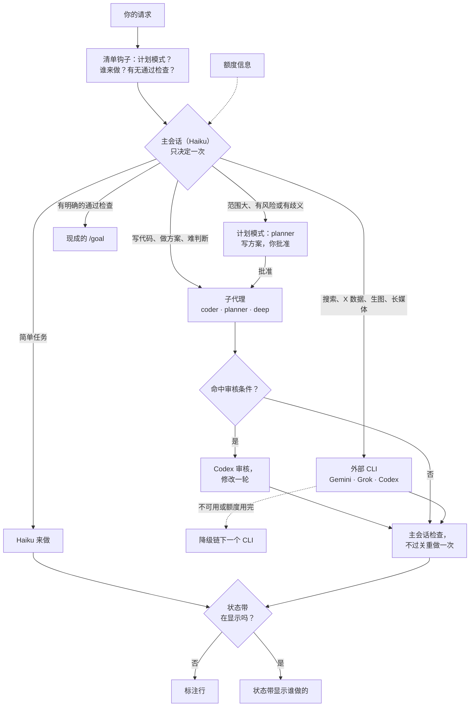

# Spick

<p align="center"></p>

**Stop picking, just start.** Spick 是 Claude Code 的分诊层。它为每个任务选模型和推理强度，并把部分任务交给你已订阅的 CLI。

[English](README.md)

## 30 秒看懂

- 主会话（Haiku）读每条请求，只决定一次谁来做。
- 子代理（`coder`、`planner`、`deep`）用固定的模型。外部 CLI（Gemini、Grok、Codex）做各自擅长的事。
- 每次回复都标明谁做的，用标注行或状态带。

## 一条请求怎么走



- 降级链：`skills/spick/references/providers.md`。审核条件：`skills/spick/SKILL.md`。
- 标注行：`[Model: Haiku 5.5 (medium) → coder Sonnet 5.5 (high) | Review: skipped]`

## 谁干什么

| 任务 | 谁来做 |
|---|---|
| 简单任务：问答、查文件、摘要 | 主会话（Haiku） |
| 改代码 | `coder` 子代理（Sonnet） |
| 规划设计 | `planner` 子代理（Opus） |
| 难推理、关键决策、正式写作 | `deep` 子代理（Opus） |
| 联网搜索、事实核查、长媒体 | Gemini（`agy`） |
| X / Twitter 数据 | Grok（`grok`） |
| 独立代码审核、生图 | Codex（`codex`） |

默认推理强度：`coder` medium，`planner` high，`deep` high。

## 仪表盘（可选）


状态带是提示框上方的一行状态栏，显示谁在做事。


`/spick` 打开面板：带快捷键的开关和最近几轮。Haiku 每条请求读一行简短的额度信息，面板显示 Claude 与 Codex 的本机额度条。

## 安装

```bash
npx skills add Brulek/spick
```

然后在 Claude Code 里说 `spick setup`。它会探测已装的 CLI，装好三个子代理，并注册分诊清单钩子。

手动安装：

```bash
bash ~/.claude/skills/spick/scripts/setup.sh --check
bash ~/.claude/skills/spick/scripts/setup.sh --install --lanes gemini,grok,codex --model haiku --effort medium
```

桌面 app 里，在模型菜单选一次 Haiku。

### 仪表盘 Mod（可选）

在终端执行：

    /plugin install spick-dashboard --marketplace Brulek/spick

状态带显示时，回复没有标注行。

## 口令

| 说 | 效果 |
|---|---|
| `spick setup` | 首次引导 |
| `spick doctor` | 已装和已登录的 CLI |
| `spick quota` | 显示额度信息 |
| `/spick on\|off\|auto` | 分流开关 |
| `/spick review on\|off` | Codex 审核步骤 |
| `/spick lane <gemini\|grok\|codex> on\|off` | 单个外部 CLI |
| `/spick hide` / `show` | 状态带，仅本会话 |
| `/spick quota` | 刷新额度信息 |

面板快捷键：`r` 分流，`v` 审核，`g` `k` `c` 对应 Gemini / Grok / Codex，`b` 状态带，`q` 刷新额度，`x` 关闭。

## 要求

- Claude Code 2.1 或更新，bash 和 python3。
- 可选：已登录的 `codex`、`grok`、`agy`。

## 目录

`skills/spick/` 放规则。`mod/spick-dashboard/` 放状态带和面板。

## 搭配使用

[alexei-led/claude-router](https://github.com/alexei-led/claude-router) 逐轮切换主会话的模型，可以一起用。Spick 不做这件事，两者可以一起用。

## 已知限制

会话不能改自己的模型和强度，所以主会话用便宜的模型。

## 许可

MIT。
