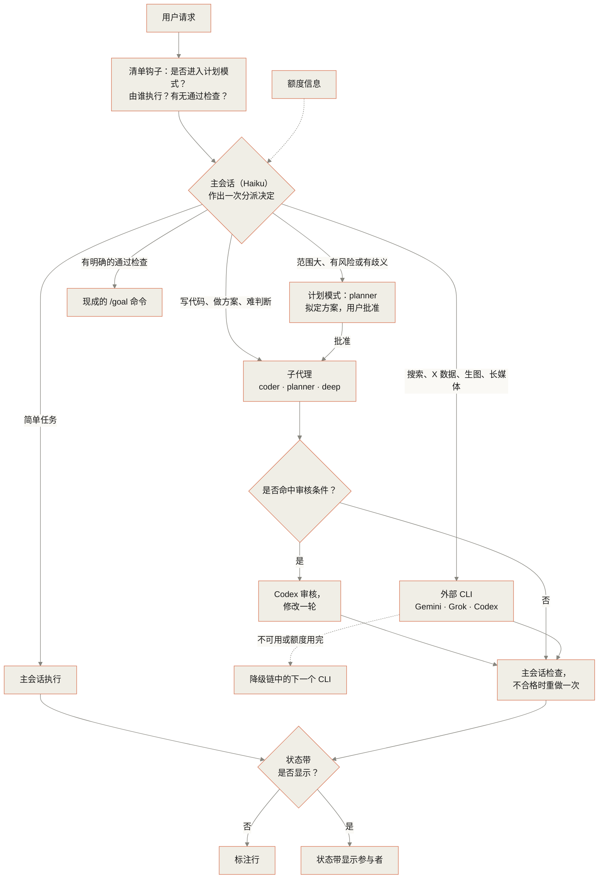

# Spick

<p align="center"></p>

<p align="center">Spick 是 Claude Code 的分诊层，为每项任务选定模型与推理强度，并将部分任务委派给用户已订阅的 CLI。</p>

Spick 让主会话保持低成本，只在真正需要的任务上动用 Opus，也让你已订阅的 Gemini、Grok、Codex CLI 不再闲置。外部 CLI 是可选的：不安装也能在 Claude 的 Sonnet 与 Opus 子代理之间分派任务。

<p align="center">
<a href="LICENSE"></a>
<a href="#环境要求"></a>
<a href="https://github.com/Brulek/spick/actions/workflows/ci.yml"></a>
</p>

<p align="center">
<a href="#快速开始">快速开始</a> · <a href="#仪表盘可选">仪表盘</a> · <a href="#命令">命令</a> · <a href="#常见问题">常见问题</a> · <a href="README.md">English</a>
</p>

## 它做什么

- 主会话（Haiku）读取每条请求，作出一次分派决定。它按交付物的形状分派：结论类交给 `deep`，涉及架构、接口或数据格式的决策交给 `planner`，跨文件的代码交给 `coder`。小活（查阅、目标明确的单文件修改）留在主会话，因为每次交接都有成本。
- 每条请求先过一遍关键词，清单里多出一行 `Hint`。这一行写明默认该走哪条路。路径、网址、代码块里的词，以及紧跟在否定词（不要、don't）后面的词，都不算数。主会话要自己接下带 Hint 的任务，必须说明一句理由。
- 子代理（`coder`、`planner`、`deep`，以及负责搜索的 `Explore`）运行于固定模型，结尾附一段简短的 Evidence（跑了哪些检查、改了哪些文件、有何局限），主会话转述时保留。外部 CLI（Gemini、Grok、Codex）承担各自擅长的任务。
- 每次回复均标明参与者，标明方式为标注行或状态带。

## 快速开始

1. 安装技能：

   ```bash
   npx skills add Brulek/spick
   ```

2. 在 Claude Code 中输入 `spick setup`。该命令探测已安装的 CLI，安装三个子代理，并注册分诊清单钩子。
3. 桌面版应用需在模型菜单中选择一次 Haiku；除非强制开启（`/spick force`），Spick 只在 Haiku 会话里分流。

手动安装、仪表盘 Mod 与卸载见[安装](#安装)。

## 工作方式



- 规则只有一份：`skills/spick/assets/rules.json`，含分派顺序、默认推理强度、Hint 关键词和清单文字。`scripts/render_rules.py` 据此生成钩子的清单、mod 的文字，以及 `SKILL.md` 与 CLAUDE.md 区块里的表格。
- 降级链见 `skills/spick/references/providers.md`；审核条件见 `skills/spick/SKILL.md`。
- 标注行格式：`[Model: Haiku 5.5 (medium) → coder Sonnet 5.5 (high) | Review: skipped]`

## 角色与模型

| 任务 | 执行者 |
|---|---|
| 查阅类（问答、文件查阅、摘要），以及目标明确的单文件修改 | 主会话（Haiku） |
| 跨文件的代码修改 | `coder` 子代理（Sonnet） |
| 架构、公共接口、数据格式或跨模块取舍的决策 | `planner` 子代理（Opus），再交 `coder` |
| 判断类：对比、评估、诊断、复杂推理、关键决策、正式文稿 | `deep` 子代理（Opus） |
| 在代码库里找文件和符号 | `Explore` 子代理（Haiku） |
| 联网搜索、事实核查、长媒体 | Gemini（`agy`） |
| X / Twitter 数据 | Grok（`grok`） |
| 独立代码审核、图像生成 | Codex（`codex`） |

默认推理强度：`coder` medium，`planner` high，`deep` medium（按任务上调：难题或跨文件问题用 high，关键决策用 xhigh）。这张表、推理强度和检查清单的文字都出自同一个文件 `skills/spick/assets/rules.json`。

**Explore 跑在 Haiku 上。** Claude Code 内置的 Explore 子代理沿用主会话的模型，Opus 会话里连 grep 也是 Opus 在跑。安装时会写入 `~/.claude/agents/Explore.md`（`model: haiku`、`effort: low`，工具为 Read、Grep、Glob、Bash）；加 `--no-explore` 则跳过。Claude Code 的子代理文档写明：用户级或项目级名为 `Explore` 的子代理会覆盖内置版本，并使用自己的模型。这是 2026-10-17 对照文档确认的行为，没有在运行时实测：`claude agents` 列出的是后台会话，不列子代理定义。所谓"只读"指工具列表和代理自己的指令，是工具层面的软约束，不是权限：Bash 命令照样能写文件。

## 仪表盘（可选）


状态带是位于输入框上方的可选单行状态栏，显示当前执行者。


`/spick` 打开面板。面板包含快捷键开关与最近几轮记录。Haiku 随每条请求读取一行简短的额度信息；面板显示 Claude 与 Codex 的本机额度条，并标出每份数据的采样时间（Claude Code 或 Codex 日志采样的时刻，而不是面板读文件的时刻）。

状态带还显示主循环最近一次请求的大小（`ctx 42k`）。Haiku 会话超过 80,000 token 时，状态带提示 `context 85k: Haiku bills 5x above 100k; /clear or delegate`：Haiku 5.5 对超过 100K token 的请求按五倍单价计费。

模组只依据事实介入，并且选在代价最小的时刻。其余内容只做展示。

**守卫**在分流生效时：

- 编辑上限：主会话每轮只能亲自改 1 个源码文件。第 2 个文件会被拒绝，拒绝信息点名已改的那个文件并要求派 `Agent(coder)`。同一文件反复改、子代理的编辑、笔记（`.md`、`.txt`）、表格（`.csv`、`.tsv`）、日志、锁文件以及开头为 `.claude/` 的路径都不计数；json、yaml、toml 计数，`.claude/worktrees/` 下的 worktree 也计数。这是工具层面的软上限：只看 Edit、Write、NotebookEdit，看不到 `sed -i`、重定向这类 Bash 写入。
- 收工测试门：本轮任何循环（含子代理）改过源码，而最后一次修改之后没有通过的检查，收工时退回。检查只在三种情况同时满足时才算数：整行是一条简单命令，命令词就是检查工具（前面可以有一个 `cd x &&`，以及 `env`、`npx`、`sudo`、`time`、`uv run` 或变量赋值；`2>&1`、`> out.txt` 这类重定向可以有；`echo pytest`、`grep pytest README` 都不算）；退出状态正常；检查在最后一次已完成的源码修改之后才开始，运行期间也没有修改在进行或完成。行里其他位置出现 `|`、`;`、`&&`、`||` 就不算：引擎只报告整行的退出状态，所以 `true || pytest`、`pytest; true`、`pytest | cat`、`npm test | tail -5` 什么也证明不了（`pytest || true`、`pytest --version` 同样不算）。每轮记录保留检查命令本身，因为模组看不到检查实际覆盖了什么：改了检查范围以外的文件，照样显示为已检查，这是已知限制。项目有自己的检查命令时，可在 `<config>/spick.json` 的 `guard.check_commands` 里用正则声明（见 `skills/spick/references/providers.md`）。主会话被要求跑项目的检查命令，或给用户一行 `/goal`，或用一行以 `Unchecked:`（或 `未验证:`）开头的话说明为何没跑。
- 升级：同一个检查在一轮里失败两次时，第二次失败的结果后面会附一行，要求主会话改派 `coder`（effort high），原因不明时派 `deep`，不要再自己修第三次。
- `/spick guard off` 可关闭守卫，选择会被记住。

**拦截**按结论类请求需要的角色检查：判断词需要 `deep`，审查词需要审查通道（带审查提示的 Codex，或标了 `review` 的通道）或 `deep`。设计类词只出现在 `Hint` 行里，从不拦截。

- 审查调用只在以下情况算数：它是这一行唯一的命令（`codex exec "<审查提示>"` 或 `invoke.py --lane <审查通道>`；可以把 diff 用管道喂给它，但 `true || codex exec "review"`、`;` 或 `&&` 串起来的命令、把输出再管道出去、`--help` 和 `--version` 都不算），结果不是错误，并且输出至少 200 个字符。`deep` 调用在其子代理正常结束时算完成；如果调用在任何结束事件之前就返回了（引擎不保证顺序），则要求调用本身的结果不是错误且不为空。
- 收工时，若该角色本轮没有完成（`deep` 子代理已结束或仍在后台运行算完成；符合上一条的审查调用算完成；被拒、失败或超时的调用不算），回复里也没有以 `Kept:`（或 `自留:`）开头的一行，且这一轮有实际工作（调过工具，或回复不少于 400 字符），就退回。
- `/spick gate off` 可关闭。

拦截与守卫合计一轮最多退回一次，所有理由放在同一段里。

**默认 effort。** 派 `coder`、`planner`、`deep` 时若没写 effort，按 `<config>/spick.json` 里 `efforts` 的默认值执行（未设置时 coder medium、planner high、deep medium）。

**每轮记录。** 每个主会话轮次在 `<config>/spick/turns/<sessionId>.jsonl` 里记一行 JSON（`<config>` 为 `CLAUDE_CONFIG_DIR`，未设置时为 `~/.claude`）：Hint、实际由谁执行（每个委派的状态、模型、effort、用量与费用；子代理自己发起的委派也会列出，`parent` 指明是哪个子代理）、拦截的每次触发及其后续、`Kept:` 行、改过的文件、每次检查及其退出状态、升级提示、主循环用量与最近一次请求大小。委派在该轮记录写入之后才结束时（后台代理，或 30 分钟没有完成信号、已记为 `timed-out` 的调用），会为同一轮追加一行带用量的 `late` 记录。`/spick spend` 汇总最近七天的费用（`scripts/spend.py`，也读取 0.x 版模组的按会话文件）；`/spick audit` 运行 `scripts/audit.py`：按 Hint 类别统计轮次与实际执行者、结论类请求的去向、拦截结果与疑似误判、改了源码却没有通过检查的轮次、升级提示、嵌套/迟到/超时的委派数、按通道和按类别的费用，以及上下文最大的几个会话。

## 安装

常规做法见上面的[快速开始](#快速开始)。

手动安装：

```bash
bash ~/.claude/skills/spick/scripts/setup.sh --check
bash ~/.claude/skills/spick/scripts/setup.sh --install --lanes gemini,grok,codex --model haiku --effort medium
```

`--install` 在写入任何文件之前，先检查 `settings.json` 和 `spick.json` 是否为合法 JSON（不合法就停下，什么都不改），再把 `CLAUDE.md`、`settings.json` 和 `spick.json` 复制到 `~/.claude/spick/backup/<时间戳>/`，并附一份 `manifest.json`，记录本次改动了什么。每一步都检查结果：某一步失败，就以退出码 1 停下，并列出已经改动的内容；只有全部步骤成功才会打印 `done`。已有的 spick hook 若指向别的路径（旧的检出目录），会改成当前这一份。已存在的子代理文件默认保留，加 `--force` 才覆盖；安装结束时会列出保留下来的文件。加 `--no-explore` 则不安装跑在 Haiku 上的 `Explore` 子代理。

状态文件放在 `~/.claude/spick/`（设了 `CLAUDE_CONFIG_DIR` 时在 `$CLAUDE_CONFIG_DIR/spick/`）：额度缓存 `quota.json`、每个会话一份的回合记录 `turns/<sessionId>.jsonl`、mod 的会话标记 `mod-active/`，以及备份。安装时会把旧版本的文件（`spick-quota.json`、`spick-spend/`、`spick-gate.jsonl`、`spick-backup/`）一次性移进来。`spick.json` 仍在 `~/.claude/`（设了 `$CLAUDE_CONFIG_DIR` 时在那里）；全部步骤成功后，最后一步写入已安装的版本，同时写入 `installed`，记录本次写了什么、保留了什么（`{"agents": {"coder": "written|kept"}, "hook": "added|updated|kept", "snippet": "replaced|appended"}`）；磁盘上的技能更新后，清单会提示 `spick: skill X installed Y, run spick setup`。

桌面版应用需在模型菜单中选择一次 Haiku。

### 仪表盘 Mod（可选）

在终端中执行：

    /plugin install spick-dashboard --marketplace Brulek/spick

状态带显示期间，回复不附标注行。

### 卸载

```bash
bash ~/.claude/skills/spick/scripts/setup.sh --uninstall [--purge] [--force]
```

它和 `--install` 一样先做备份。然后只移除安装时写入的内容：

- `CLAUDE.md` 里 spick 标记之间的块；
- `settings.json` 里的清单钩子；
- 四个子代理（`coder`、`planner`、`deep`、`Explore`）；
- 额度缓存与 mod 的会话标记。

它不动的内容：

- `model` 与 `effortLevel` 只有仍是安装时设的值，才恢复为安装前的值。
- 你改过的子代理文件会保留，加 `--force` 才删除。
- `spick.json` 与 `~/.claude/spick/`（回合记录、备份）默认保留，加 `--purge` 才一并删除。

剩下两步需要你自己做：`claude plugin uninstall spick-dashboard`，以及删除 `~/.claude/skills/spick`。

## 命令

| 命令 | 作用 |
|---|---|
| `spick setup` | 首次配置 |
| `spick doctor` | 列出已安装及已登录的 CLI |
| `spick quota` | 显示额度信息 |
| `/spick on\|force\|off` | 分流开关：`on` 只在 Haiku 会话里分流，`force` 任何模型都分流 |
| `/spick review on\|off` | Codex 审核步骤开关 |
| `/spick gate on\|off` | 拦截开关：主会话自己答了带 Hint 的结论类任务，收工时退回一次 |
| `/spick guard on\|off` | 守卫开关：主会话每轮最多亲自改 1 个源码文件（第二个会被拒绝，交给 `coder`）；改了源码却没有通过检查的一轮，收工时退回一次。这个上限是工具层面的软约束：经 Bash 做的修改（`sed -i`、重定向）不计入 |
| `/spick lane <id>` | 显示单个 lane 的记录 |
| `/spick lane <id> on\|off` | 开关某个 lane（字段 `enabled`，写入 `spick.json`） |
| `/spick lane <id> <field> <value>` | 经 `set_lane.py` 修改 lane 的任意字段（tags 用逗号分隔） |
| `/spick hide` / `show` | 隐藏或显示状态带，仅限本会话 |
| `/spick quota` | 刷新额度信息 |
| `/spick spend` | 近 7 天各 lane 的花费（`scripts/spend.py`；手动运行可加 `--days N`、`--by lane\|day\|session`、`--json`） |
| `/spick audit` | 近 7 天回合记录的统计：各类 Hint 实际由谁完成、拦截触发及其结果、改了却没通过检查的回合、各 lane 花费（`scripts/audit.py --days N`） |

`/spick spend` 和 `/spick audit` 的数据从哪来：mod 为每个会话写一份回合记录 `~/.claude/spick/turns/<sessionId>.jsonl`，每个主回合一行，记下谁干了活、用量、拦截和检查。旧版本的会话从原来的逐会话花费文件读取。没有 mod 就没有记录：bash 钩子拿不到用量。

面板快捷键：`r` 分流，`v` 审核，`e` 拦截，`d` 守卫，`g` `k` `c` 对应 Gemini / Grok / Codex，`l` lane 设置页（改 tags、data 等；移动端无输入框），`b` 状态带，`q` 刷新额度，`x` 关闭。

## 环境要求

- Claude Code 2.1 或更高版本，bash 与 python3。
- 可选：已登录的 `codex`、`grok`、`agy`。
- 线路密钥用 `keychain:<名称>` 仅限 macOS；Linux 与 Windows 请用 `env:<变量名>`。
- 安装脚本、钩子、各脚本（`scripts/paths.py` 是唯一的路径规则）和仪表盘 Mod 都认 `CLAUDE_CONFIG_DIR`：状态文件放在 `<config>/spick/`。

## 常见问题

### Spick 会切换主会话的模型吗？

不会。Spick 不改主会话的模型。想逐轮切换，可与 Spick 同时运行 claude-router。见[已知限制](#已知限制)。

### 在 Sonnet、Opus 或 Fable 会话里

在 `/spick on`（默认）下，这类会话按设计不分流：主模型自己就能做，清单换成一句说明。不装仪表盘 Mod 时，CLAUDE.md 区块也是同样的规则。`/spick force` 在任何模型上都保留委派：编辑仍交给 `coder` 在它自己的上下文里执行，`deep` 仍给出独立的第二意见，尽管主模型自己也能做。长会话里主上下文会被编辑细节塞满时，或判断类结论想让全新上下文复核时，值得这样做。

### Gemini、Grok、Codex 是必需的吗？

不是。`codex`、`grok`、`agy` 都是可选的；要用哪个，就先登录哪个。`spick doctor` 会列出哪些已安装、已登录。

### 安装改了本机哪些东西，能撤销吗？

`--install` 在写入任何文件之前，先把 `CLAUDE.md`、`settings.json` 和 `spick.json` 备份到 `~/.claude/spick/backup/<时间戳>/`。`--uninstall` 只移除安装时写入的内容，见[卸载](#卸载)。

### 不装仪表盘 Mod 能用吗？

能。没有状态带时，回复用标注行标明参与者。花费记录需要 mod：bash 钩子拿不到用量。

### lane 密钥放在哪？

用 `keychain:<名称>` 保存的密钥仅限 macOS。Linux 与 Windows 请用 `env:<变量名>`。

## 已知限制

Spick 不改主会话的模型。模组可以改写每次请求的模型与推理强度（Claude Code 2.1.299 引擎类型中的 `turn.step`），claude-router 与 claude-agent-tools 就是这样做的；Spick 把这件事留给它们、与 claude-router 配合使用，所以主会话跑在低成本模型上，靠清单分派。清单只是建议：主会话仍可能把本该委派的任务留给自己，`Hint` 行和按交付物形状排列的第二项就是为了防这一点。

- Hint 行是关键词匹配，不是分类器：措辞里没有关键词的结论类请求它会漏掉，也会在少数不该触发的地方触发（"版本号"会被当作联网信号）。它的标注语料是 `skills/spick/scripts/testdata/hint_corpus.json`。
- lane 的 `data` 级别是用户声明的上限，不是敏感数据检测。`scripts/invoke.py` 会拒绝超出上限的调用（退出码 6），没写 `--contains` 时按 code 处理，在 `text` 或 `public` 声明下还会扫描像代码的内容；它不查找密钥或个人信息。
- 守卫的改文件上限和 `Explore` 的只读工具列表都是工具层面的软约束：Bash 命令照样能写文件。
- 用户级 `Explore` 取代内置版本，是 Claude Code 文档的说法，本项目没有在运行时实测。

## 相关项目

[alexei-led/claude-router](https://github.com/alexei-led/claude-router) 逐轮切换主会话的模型，可与 Spick 同时使用。

## 参与贡献

欢迎提 issue 和 PR。

目录结构：`skills/spick/` 放分诊规则；`mod/spick-dashboard/` 放状态带与面板。分派规则在 `skills/spick/assets/rules.json`：改完后运行 `python3 skills/spick/scripts/render_rules.py`（CI 的单测会跑 `--check`，生成的副本与规则不一致就失败）。各版本的改动见 [CHANGELOG.md](CHANGELOG.md)。

CI（`.github/workflows/ci.yml`）跑 python 单测与 mod 测试。在本地运行，请在仓库根目录执行：

- python 单测：`cd skills/spick/scripts && python3 -m unittest -q`
- mod 测试：`claude plugin test mod/spick-dashboard`

本文插图由 mod 自身的状态带与表格代码生成。重新生成请在仓库根目录运行 `node --experimental-strip-types docs/images/make-art.mts`。

## 请作者喝杯咖啡

Spick 免费，采用 MIT 许可。如果它帮你省了时间、你想支持作者，可以在 BNB Smart Chain 上打赏。

<p><br>
<sub>BNB Smart Chain · 用于支持作者</sub></p>

地址（BNB Smart Chain）：

    0x25Ca60556e44a9Fe213cC45177F04413094975F9

只在 BNB Smart Chain 上转账；转到其他网络的资产可能无法找回。

## 许可证

MIT，见 [LICENSE](LICENSE)。

## 评测

`skills/spick/evals/ab/` 是一套 A/B 评测：用 `claude -p` 把八个小任务分别交给 spick 臂和若干基线（单模型、可自由委派）去做，再用精确检查、隐藏测试和盲评打分，报告给出质量、完成率、每次成功交付的成本和耗时分位数。它说明的是这些任务上的情况，不能证明在一般任务上不劣于大模型。臂的定义、参数、局限和完整矩阵的命令见 [skills/spick/evals/ab/README.md](skills/spick/evals/ab/README.md)。
