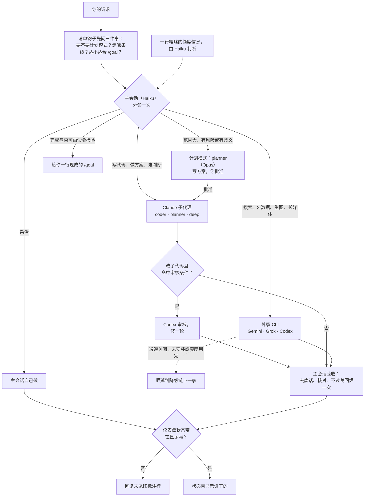

# Spick

<p align="center"></p>

**Stop picking, just start.** 给 Claude Code 装一层统一分诊：决定用哪档 Claude 模型、什么推理强度，以及什么时候把活交给你已经订阅的其它 AI 命令行。

[English](README.md)

## 30 秒看懂

- **Haiku 当主会话，每条请求分诊一次。** 它小而便宜，只负责决定谁来干，而不是什么都自己干。
- **活交给钉死模型的子代理，或交给你已订阅的命令行。** 每个被委派方按任务拿到一个推理强度。
- **随时看得出这轮谁干的。** 回复末尾印一行标注，或由仪表盘状态带显示。Claude 是工作的默认承担者；没装的 CLI 自动跳过，只装了 Claude 也能用，退化成纯 Claude 内部分层。

## 一条请求怎么走



- 各条线的降级链见 `skills/spick/references/providers.md`。
- Codex 审核只在一张简短的触发清单命中时才做（碰钱碰权限碰定时任务、改动大、没测试、报告里带"不确定"），触发条件见 `skills/spick/SKILL.md`。
- 标注行长这样：`[Model: Haiku 5.5 (medium) → coder Sonnet 5.5 (high) | Review: skipped]`

## 谁干什么

| 任务 | 交给谁 |
|---|---|
| 日常杂活（问答、查文件、摘要、跑脚本） | 主会话自己 |
| 改代码 | `coder` 子代理，钉死 Sonnet |
| 规划设计 | `planner` 子代理，钉死 Opus |
| 高难推理、关键决策、正式写作 | `deep` 子代理，钉死 Opus |
| 联网搜索、事实核查、长视频音频、超长文档 | Gemini（`agy`，Antigravity CLI） |
| X / Twitter 数据 | Grok（`grok`，Grok Build） |
| 独立代码审核、生图 | Codex（`codex`，ChatGPT 订阅） |

默认推理强度：`coder` Medium，`planner` High，`deep` High。分诊层会按任务上调或下调。

## 仪表盘（可选）


提示框上方的状态带显示此刻谁在干活，空闲时显示上一轮谁干的；需要留意的原因（Codex 审核、改了源码文件）显示在右侧。


`/spick` 打开面板：分流、审核、外家通道的开关和快捷键，以及最近几轮记录。其下面板还有额度区，显示一行粗略的额度信息，由 Haiku 判断；以及本会话成本区，按通道列出估算成本。

## 安装

```bash
npx skills add Brulek/spick
```

然后开一个 Claude Code 会话，说 `spick setup`。引导会探测装了哪些 CLI、登录没有，问你启用哪几家、主会话用什么模型，把三个子代理装进 `~/.claude/agents/`，往 `~/.claude/CLAUDE.md` 写一段速查表，注册一个逐条提问的分诊清单钩子（`scripts/triage-hook.sh`，即 `~/.claude/settings.json` 里的 `UserPromptSubmit` 钩子），并可选地把默认模型和推理强度写进 `~/.claude/settings.json`。

手动等价命令：

```bash
bash ~/.claude/skills/spick/scripts/setup.sh --check
bash ~/.claude/skills/spick/scripts/setup.sh --install --lanes gemini,grok,codex --model haiku --effort medium
```

桌面 app 用户：在输入框旁的模型菜单里选一次 Haiku。app 会记住自己的选择，并覆盖 `settings.json`。

### 仪表盘 Mod（可选）

在终端会话里执行：

    /plugin install spick-dashboard --marketplace Brulek/spick

回答 `y` 添加 marketplace，选 user 范围；之后提示框上方出现状态带显示谁在干活，`/spick` 打开面板。状态带显示期间（终端或桌面 app）回复不再印标注行；`/spick hide` 隐藏状态带后标注行恢复。

## 口令

| 说 | 效果 |
|---|---|
| `spick setup` | 首次引导，可重复运行 |
| `spick doctor` | 探测表：装没装、登没登录、版本 |
| `spick quota` | `~/.claude/spick.json` 里列出的订阅的额度信息；`--refresh` 立即采集 |
| `/spick on\|off\|auto` | 分流开关（auto＝只在 Haiku 会话里开；用 `/model` 手动选模型后本会话自动关） |
| `/spick review on\|off` | Codex 审核步骤 |
| `/spick lane <gemini\|grok\|codex> on\|off` | 单个外家通道 |
| `/spick hide` / `show` | 状态带，仅本会话 |
| `/spick quota` | 立即刷新额度信息 |

分流、审核、通道这三类选择跨会话记住。

面板快捷键：`r` 分流（切到下一个值），`v` 审核，`g` `k` `c` 分别是 Gemini / Grok / Codex 通道，`b` 状态带，`q` 刷新额度，`x` 关闭。

## 要求

- Claude Code 2.1 以上（子代理支持 `model` / `effort` frontmatter）。
- 两个脚本需要 bash 和 python3（Windows 用 Git Bash 或 WSL）。
- 可选：已登录订阅的 `codex`、`grok`、`agy`；生图需要 Claude Code 的 `codex-image` 插件。
- 可选：重新生成 README 配图需要 Node 22.6 以上。

## 目录

```
skills/spick/
├── SKILL.md                 分诊规则
├── references/providers.md  各家咒语、参数、模型名、额度来源、坑
├── references/onboarding.md 首次引导流程
├── scripts/quota.sh         额度采集器（quota.py）与缓存
├── scripts/setup.sh         探测与安装
└── assets/                  子代理定义、CLAUDE.md 片段
mod/spick-dashboard/         仪表盘 Mod（提示框上方状态带、/spick 面板）
docs/images/                 README 配图及其生成脚本
```

## 搭配使用

- [alexei-led/claude-router](https://github.com/alexei-led/claude-router)：一个 Claude Code Mod，用本地或托管分类器逐轮切换主会话的模型与推理强度。它解决本技能做不到的那件事（给主会话换挡），本技能补上它不管的部分（外家 CLI、审核触发、额度感知、引导）。两者可以组合使用。
- [tzachbon/claude-model-router-hook](https://github.com/tzachbon/claude-model-router-hook)：基于 hook 的变体，只能提醒或设置下一个会话的模型。

## 已知限制

- Claude Code 会话不能改自己的模型和强度，只能给被委派方定价。所以主会话用便宜的，其余全部钉死。
- 云端 agent（Codex Cloud、ChatGPT agent mode、Grok 网页任务）不在范围内。

## 许可

MIT 协议。
