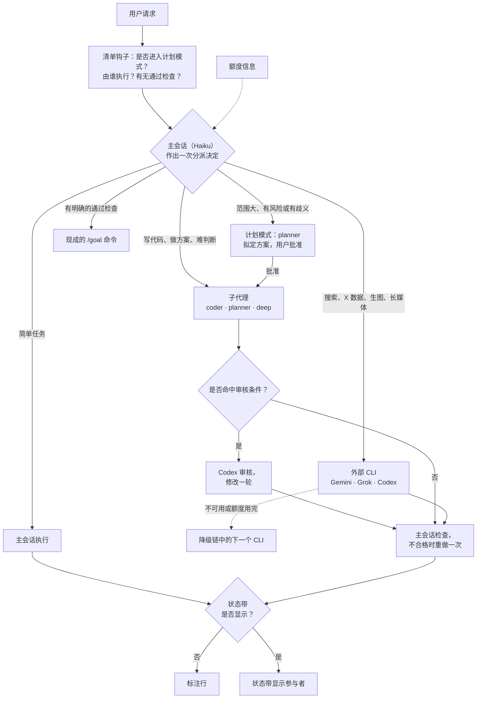

# Spick

<p align="center"></p>

**Stop picking, just start.**

Spick 是 Claude Code 的分诊层，为每项任务选定模型与推理强度，并将部分任务委派给用户已订阅的 CLI。

[English](README.md)

## 概述

- 主会话（Haiku）读取每条请求，并作出一次分派决定。
- 子代理（`coder`、`planner`、`deep`）运行于固定模型；外部 CLI（Gemini、Grok、Codex）承担各自擅长的任务。
- 每次回复均标明参与者，标明方式为标注行或状态带。

## 请求流程



- 降级链见 `skills/spick/references/providers.md`；审核条件见 `skills/spick/SKILL.md`。
- 标注行格式：`[Model: Haiku 5.5 (medium) → coder Sonnet 5.5 (high) | Review: skipped]`

## 角色与模型

| 任务 | 执行者 |
|---|---|
| 简单任务：问答、文件查阅、摘要 | 主会话（Haiku） |
| 代码修改 | `coder` 子代理（Sonnet） |
| 规划与设计 | `planner` 子代理（Opus） |
| 复杂推理、关键决策、正式文稿 | `deep` 子代理（Opus） |
| 联网搜索、事实核查、长媒体 | Gemini（`agy`） |
| X / Twitter 数据 | Grok（`grok`） |
| 独立代码审核、图像生成 | Codex（`codex`） |

默认推理强度：`coder` medium，`planner` high，`deep` high。

## 仪表盘

仪表盘为可选组件。


状态带是位于输入框上方的单行状态栏，显示当前执行者。


`/spick` 打开面板。面板包含快捷键开关与最近几轮记录。Haiku 随每条请求读取一行简短的额度信息；面板显示 Claude 与 Codex 的本机额度条。

## 安装

```bash
npx skills add Brulek/spick
```

随后在 Claude Code 中输入 `spick setup`。该命令探测已安装的 CLI，安装三个子代理，并注册分诊清单钩子。

手动安装：

```bash
bash ~/.claude/skills/spick/scripts/setup.sh --check
bash ~/.claude/skills/spick/scripts/setup.sh --install --lanes gemini,grok,codex --model haiku --effort medium
```

桌面版应用需在模型菜单中选择一次 Haiku。

### 仪表盘 Mod（可选）

在终端中执行：

    /plugin install spick-dashboard --marketplace Brulek/spick

状态带显示期间，回复不附标注行。

## 命令

| 命令 | 作用 |
|---|---|
| `spick setup` | 首次配置 |
| `spick doctor` | 列出已安装及已登录的 CLI |
| `spick quota` | 显示额度信息 |
| `/spick on\|off\|auto` | 分流开关 |
| `/spick review on\|off` | Codex 审核步骤开关 |
| `/spick lane <id>` | 显示单个 lane 的记录 |
| `/spick lane <id> on\|off` | 开关某个 lane（字段 `enabled`，写入 `spick.json`） |
| `/spick lane <id> <field> <value>` | 经 `set_lane.py` 修改 lane 的任意字段（tags 用逗号分隔） |
| `/spick hide` / `show` | 隐藏或显示状态带，仅限本会话 |
| `/spick quota` | 刷新额度信息 |

面板快捷键：`r` 分流，`v` 审核，`g` `k` `c` 对应 Gemini / Grok / Codex，`l` lane 设置页（改 tags、data 等；移动端无输入框），`b` 状态带，`q` 刷新额度，`x` 关闭。

## 环境要求

- Claude Code 2.1 或更高版本，bash 与 python3。
- 可选：已登录的 `codex`、`grok`、`agy`。

## 目录结构

`skills/spick/`：分诊规则。`mod/spick-dashboard/`：状态带与面板。

## 相关项目

[alexei-led/claude-router](https://github.com/alexei-led/claude-router) 逐轮切换主会话的模型。Spick 不提供该功能，两者可配合使用。

## 已知限制

会话无法更改自身的模型与推理强度，因此主会话采用低成本模型。

## 许可证

MIT。
